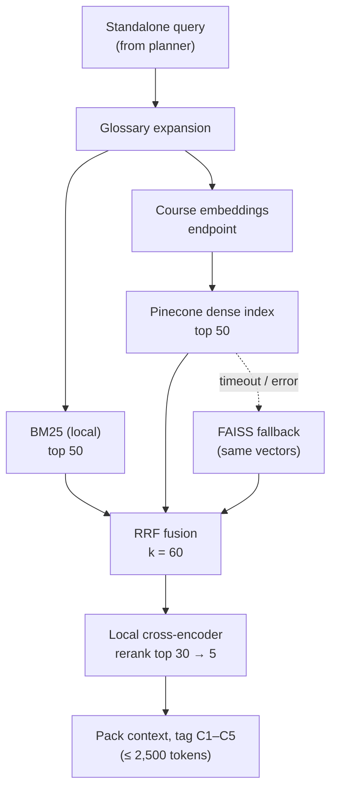

# ADR-002: Retrieval stack (BM25 + Pinecone + RRF + reranker, FAISS fallback)

| | |
|---|---|
| **Status** | **Accepted** (mentor email, 18 Nov 2026): Pinecone with FAISS fallback approved; reranker comparison requested |
| **Date** | 18 Nov 2026 (accepted the same day) |
| **Owner (role)** | RAG / retrieval |
| **Affects** | LLD 3 (retrieval), LLD 6 (`policy_search`), LLD 11 (deployment) |

## Context

- Track B limits *model* calls to the hosted ≤8B chat endpoint and the course embeddings endpoint.
- The mentor (17 Nov) said retrieval tooling is our choice: *"how to do it, it's your choice… a simple search tool or some other kind."*
- Six people work on the project, and the app will run on AWS for about a week, so everyone needs to use **one shared index** without each person re-embedding the corpus.
- The design needs keyword *and* semantic recall, fusion that doesn't require calibrating scores, and separate measurements for BM25 only, dense only and hybrid (the ablations).

## Decision

1. **Sparse:** BM25 runs inside our own code (`rank_bm25`), with lower-casing and numbers kept as tokens.
2. **Dense:** vectors come **only** from the course embeddings endpoint (`bge-small-en-v1.5`, 384-d) and are stored in **Pinecone serverless**: the team's existing index `hr-policy-navigator` (free Starter plan, AWS `us-east-1`, cosine metric).
    - We do **not** use Pinecone's built-in embedding, reranking or single-index hybrid search.
    - One namespace per corpus version and chunking variant, e.g. `lab-c3` while experimenting and `v2-c3` for the release. Vector ID = the string `chunk_id` (e.g. `doc_135::c3::004`). Never rebuild IDs from numeric metadata, because Pinecone returns numbers as floats (repo review, gate 6).
3. **Fusion:** Reciprocal Rank Fusion in our own code. Metadata (employee type, location) **boosts** results in code; we don't use Pinecone's hard filters, so a missing tag never hides the right clause.
4. **Rerank:** a local cross-encoder scores the top 30 and keeps the top 5. As the mentor suggested, we **compare `BAAI/bge-reranker-base` and `cross-encoder/ms-marco-MiniLM-L6-v2`** on strict recall@k, MRR and CPU latency (Step 3 lab) and record the winner here. If nothing passes the calibrated score threshold, the tool returns `no_relevant_policy`.
5. **Abstraction:** a `VectorStore` interface with `PineconeStore` and `FaissStore` behind it, selected by `VECTOR_BACKEND`. FAISS also takes over automatically if Pinecone times out (2 s) or returns an error, and the result is flagged `degraded: true`.
6. **Source of truth:** chunk text and metadata live in local files in the repo. Pinecone holds only vectors plus `doc_id`, `variant` and `pages`.
7. **Measurement:** retrieval hits are scored against `gold_doc_ids` / `gold_pages` (eval v1.1), not answer-word overlap (repo review, gate 5).

## Alternatives considered

| Option | Pros | Cons | Verdict |
|---|---|---|---|
| FAISS only (in-process) | No network, nothing to pay | Each person and each container rebuilds the index; no managed-service story | Kept as the fallback |
| Pinecone single-index hybrid (sparse + dense) | One query | Replaces RRF with a weighted mix that needs score tuning; blurs the ablations | Rejected |
| Pinecone built-in embedding and reranking | Less code | Breaks the Track B model constraint | Rejected |
| pgvector / OpenSearch | Familiar | More infrastructure to run in 9 days | Rejected |

## Consequences

- **Positive:** one shared index for the team and the deployed app; the ablations stay clean; one config flag switches back to fully local.
- **Negative:** a network round trip to `us-east-1` on every query, so we measure p50/p95 latency. The Starter plan allows only 2 user seats, so one owner holds the account and the others use API keys. The API key has to be managed as a secret.
- **Limits (Starter):** 1 project, 5 serverless indexes, 2 GB storage, 100 namespaces per index, `us-east-1` only. Our corpus is far below these.

## Validation

- FAISS and Pinecone recall@5 within 1 point of each other on the same chunks.
- The shared `policy_search` contract test passes on both backends.
- Pinecone query p95 under 1 s from AWS `us-east-1`.

## Mentor answers (email, 18 Nov 2026)

1. **External vector store:** *"Pinecone with fallback sounds good."* Accepted.
2. **Reranker:** try `BAAI/bge-reranker-base` or `cross-encoder/ms-marco-MiniLM-L6-v2`, *"or both if you have time and that would be an interesting comparison."* We run both.

## Results (Step 3 lab, 22 Nov 2026: 80 questions, strict gold-doc metric, Shubhi's laptop CPU)

| Item | Value |
|---|---|
| Chosen chunking variant | **C3 heading-aware** (hybrid+MiniLM: R@1 0.800 vs 0.775 for C1, MRR 0.871 vs 0.843; same R@5 0.950) |
| Chosen reranker | **ms-marco-MiniLM-L6-v2**: better than bge-reranker-base on C3 (MRR 0.871 vs 0.845) and about 7.5× faster |
| Rerank latency (30 pairs, CPU) | MiniLM p50 1.7 s / p95 4.3 s; bge-base p50 12.5 s / p95 23.0 s (too slow to deploy) |
| Gain over the original setup | BM25-only C1 → hybrid+MiniLM C3: R@1 0.625 → 0.800 (+17.5 pts), MRR 0.751 → 0.871 |
| Pinecone vs FAISS parity | Identical on all three variants ✅ |
| BGE query instruction helps? | No measurable gain (C3: R@1 0.713 with vs 0.738 without; mixed on C1/C2) → **off** |
| Dense alone vs BM25 (C3) | R@5 0.900 vs 0.950: exact terms (amounts, tool names) matter in this corpus, so hybrid is needed |
| `no_relevant_policy` threshold | **0.25** (MiniLM score): keeps 95% of in-scope questions, refuses 10 of 12 off-topic probes (83%). The 2 that slip through go to the critic and refusal prompt (second line of defence) |

Caveat: one question = 1.25 points; differences under about 3 points are within noise. The reranker choice is clear (speed); the C3 vs C1 choice is a small edge.
