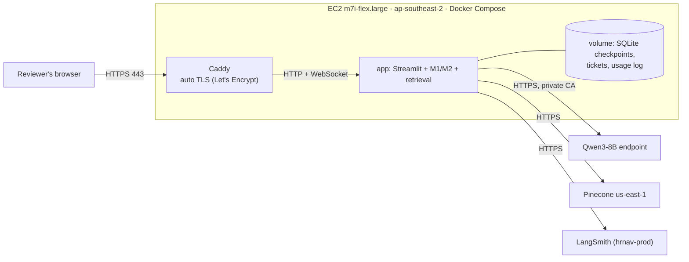

# ADR-007: Deploy on one AWS EC2 instance in Sydney with Docker Compose and Caddy for HTTPS

| | |
|---|---|
| **Status** | Proposed (revised 22 Nov: Sydney region, Streamlit, Caddy, no Redis) |
| **Date** | 18 Nov 2026, revised 22 Nov 2026 |
| **Owner (role)** | Front-end & deployment |
| **Affects** | HLD deployment view, LLD 11 (containers), ADR-005 |

## Context

- We want reviewers to use the live app for about a week around evaluation, paid from AWS sign-up credits.
- The new AWS account fixes the region to **Sydney (`ap-southeast-2`)**. From CloudShell there we confirmed the model endpoint and Pinecone (`us-east-1`) are both reachable.
- The app (ADR-005) is one Python process: Streamlit, LangGraph with a SQLite checkpointer, BM25 and FAISS files, the bge-small embedder and the MiniLM reranker on CPU (about 3 GB RAM in total).
- Rate limiting, caching and the daily cap run in-process (ADR-005), so a separate Redis is not needed with a single container.

## Decision

1. **Compute:** one EC2 instance, Ubuntu 24.04, 30 GB gp3, Elastic IP, in `ap-southeast-2`. The account is on the AWS Free plan, which only allows free-tier-eligible types: **`m7i-flex.large` (2 vCPU, 8 GB)** first choice, **`c7i-flex.large` (2 vCPU, 4 GB) plus a 4 GB swap file** as fallback. `t3.large` is not available on the Free plan.
2. **Containers:** `docker-compose.yml` with `app` (built from `Dockerfile`) and `caddy`. CPU-only torch; the embedder and reranker are baked into the image so start-up needs no downloads; the app runs as a non-root user; a health check on `/_stcore/health`; log rotation; `restart: unless-stopped`.
3. **HTTPS without a domain:** Caddy serves `<elastic-ip-with-dashes>.sslip.io` and gets a Let's Encrypt certificate automatically.
4. **Secrets:** a `.env` file on the instance only (`chmod 600`), read by Compose. Never in the image (`.dockerignore` excludes it) or in git.
5. **Access control:** security group opens 80 and 443 to everyone and 22 only to the deployer's IP; the app asks for a shared access code; per-client rate limit and a daily model-call cap protect the shared endpoint key.
6. **Operations:** an AWS Budget alert at $10; LangSmith project `hrnav-prod` for live traces; the FAISS fallback covers a Pinecone outage. Live until about Fri 4 Dec, then terminate the instance and release the Elastic IP.

## Alternatives considered

| Option | Pros | Cons | Verdict |
|---|---|---|---|
| **EC2 + Compose + Caddy** | One box, cheap, same Compose file locally and on AWS, free HTTPS | Single instance, no high availability | **Chosen** |
| EC2 + CloudFront (original plan) | HTTPS on a `cloudfront.net` name | Extra service to configure; WebSocket and caching rules to get right for Streamlit | Replaced by Caddy |
| ECS Fargate + ALB | Managed | ALB hourly cost; SQLite needs EFS; much more setup | Rejected |
| Redis for rate limits and cache | Shared across replicas | Only one replica; one more container to run | Rejected |
| GitHub Actions + ECR + SSM deploy | Repeatable releases | Setup time we don't have; one manual deploy is enough for a week-long demo | Deferred |
| SSM Parameter Store for secrets | Secrets never on disk | IAM role and fetch script to write | Deferred; `.env` with `chmod 600` instead |

## Consequences

- **Positive:** a reviewer opens one HTTPS link; restarts keep conversations (named volume); the whole deployment is three files.
- **Negative:** single instance; Sydney to `us-east-1` adds about 200 ms to each Pinecone query, small next to model latency.
- **Estimated cost:** free-tier-eligible instance hours are covered by the Free plan credits; storage and the public IPv4 address add a few dollars over 12 days. Stop the instance when not needed.

## Validation

- The HTTPS URL works from a phone on mobile data.
- Restarting the `app` container mid-conversation keeps the M2 thread.
- A burst of 15 questions in a minute from one client is rate-limited after 10.
- Budget alert stays under $10 by 4 Dec.
