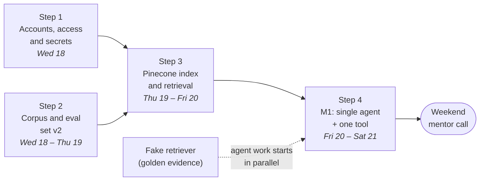

# HR Policy Navigator: Build Runbook, Steps 1–4

**From accounts to the first working agent (M1)**  
**Prepared by:** Shubhi Saxena · **Date:** 18 Nov 2026 · **Covers:** Wed 18 – Sat 21 Nov 2026  
**Related:** ADR-001 to ADR-007 (decision pack), HLD + LLD architecture doc  

## At a glance



| Step | Owner (role) | Depends on | Output | Target |
|---|---|---|---|---|
| 1. Accounts, access and secrets | Front-end & deployment | none | Working keys for AWS, Pinecone, LangSmith and the course endpoints; `.env.example`; access smoke test | Wed 18 Nov |
| 2. Corpus and eval set v2 | Domain spec & eval design + RAG | none | Extraction QC log, stable IDs, `eval_v2.jsonl` (frozen) | Thu 19 Nov |
| 3. Pinecone index and retrieval | RAG / retrieval | Steps 1, 2; ADR-002 | Populated index, `policy_search` passing its contract test, parity report | Fri 20 Nov |
| 4. M1 single agent | Agent orchestration + prompt engineering | Step 3 (or the fake retriever); ADR-003, ADR-004 | M1 results on 80 and on v2, failure analysis, mentor-call pack | Sat 21 Nov |

**Steps 1 and 2 run in parallel. The agent owner starts Step 4 against a fake retriever on day 1 and switches to the real index after Step 3.**

---

## Step 1: Accounts, access and secrets

**Owner:** Front-end & deployment · **Support:** RAG (Pinecone), Observability (LangSmith) · **Target:** Wed 18 Nov

### Prerequisites

- [ ] One person owns each account. Pinecone's Starter plan allows only **2 user seats**, so everyone else uses API keys.
- [ ] A payment card for AWS sign-up. AWS asks for one even on the Free plan; nothing is charged while you stay on that plan.
- [ ] Course endpoint details: base URL, model names and API keys for the ≤8B chat model and the embeddings model.
- [ ] Repo admin rights (to add `.gitignore`, pre-commit hooks and Actions secrets).
- [ ] A team password manager or secure vault for sharing keys. **Never paste keys into chat.**

### Actions

**1.1 AWS account (about 45 min)**

1. Create a new AWS account on the **Free plan**: $100 credit at sign-up, plus up to $100 more for starter activities, for 6 months.
2. Turn on **MFA for the root user**, then stop using root.
3. Create an admin identity for day-to-day work: an IAM Identity Center user, or an IAM user `capstone-admin`, with MFA.
4. Set the default region to **`us-east-1`** (the same region as Pinecone; see ADR-007).
5. **Billing → Budgets:** create a $10 monthly cost budget with email alerts at 50%, 80% and 100% to the team mailing list. This also earns $20 of activity credit.
6. Optional: complete the other credit activities (launch and terminate an EC2 instance, etc.) for up to $100 more.
7. Check that the Free plan allows EC2, ECR, CloudFront and SSM. If not, switch to the Paid plan; credits still apply.

**1.2 Pinecone (about 15 min)**

1. The owner creates the organisation and a project called `hr-policy-navigator`.
2. Create two API keys: `hrnav-dev` (local and eval) and `hrnav-prod` (AWS only).
3. Note the Starter limits: 1 project, 5 serverless indexes, 2 GB storage, 100 namespaces per index, `us-east-1` only.

**1.3 LangSmith (about 10 min)**

1. Create three projects: `hrnav-dev`, `hrnav-eval` and `hrnav-prod`.
2. Create an API key. Tracing is turned on with environment variables (see 1.5).

**1.4 Check the course endpoints (about 30 min). This is the most important check in Step 1**

| Check | Why it matters | Result |
|---|---|---|
| Is the API OpenAI-compatible (`/v1/chat/completions`, `/v1/embeddings`)? | Decides the client library | |
| Does the chat model support **native tool/function calling**? | M1 depends on it; otherwise use the JSON-action fallback (Step 4.4) | |
| Embedding dimension and max input tokens | Fixes the Pinecone index dimension and chunk cap | |
| Rate limits (requests/min, tokens/min) | Eval run time; rate limits on the public deployment | |
| Key valid until at least **4 Dec 2026**? | The app stays live after submission | |
| Reachable from an AWS IP? (test from **AWS CloudShell** in `us-east-1`) | Some course endpoints restrict IPs | |

**1.5 Secrets handling (about 20 min)**

- Commit `.env.example`, with no values, and git-ignore `.env`:

```bash
# .env.example
LLM_BASE_URL=
LLM_API_KEY=
LLM_MODEL=
EMBED_BASE_URL=
EMBED_API_KEY=
EMBED_MODEL=
PINECONE_API_KEY=
PINECONE_INDEX=hrnav-dense
PINECONE_NAMESPACE=v2-c3
VECTOR_BACKEND=pinecone        # pinecone | faiss
RETRIEVER=fixture              # fixture | bm25 | hybrid
LANGSMITH_TRACING=true
LANGSMITH_API_KEY=
LANGSMITH_PROJECT=hrnav-dev
```

- Add a pre-commit secret scanner (e.g. `gitleaks` or `detect-secrets`) so a key can't be committed by accident.
- Production secrets go into **SSM Parameter Store** (`SecureString`, path `/hrnav/prod/*`) later, at deployment time (ADR-007).

**1.6 Access smoke test.** Every team member runs `scripts/smoke_access.py`:

```python
"""Checks every external dependency with one cheap call each."""
import os, time
from dotenv import load_dotenv
from openai import OpenAI
from pinecone import Pinecone
from langsmith import Client

load_dotenv()

def timed(name, fn):
    t = time.perf_counter()
    try:
        out = fn()
        print(f"OK   {name:<11} {1000*(time.perf_counter()-t):6.0f} ms  {out}")
    except Exception as e:
        print(f"FAIL {name:<11} {e}")

llm = OpenAI(base_url=os.environ["LLM_BASE_URL"], api_key=os.environ["LLM_API_KEY"])
emb = OpenAI(base_url=os.environ["EMBED_BASE_URL"], api_key=os.environ["EMBED_API_KEY"])

timed("chat", lambda: llm.chat.completions.create(
    model=os.environ["LLM_MODEL"],
    messages=[{"role": "user", "content": "Reply with OK"}],
    max_tokens=5).choices[0].message.content)
timed("embeddings", lambda: f"dim={len(emb.embeddings.create(model=os.environ['EMBED_MODEL'], input=['test']).data[0].embedding)}")
timed("pinecone", lambda: Pinecone(api_key=os.environ["PINECONE_API_KEY"]).list_indexes().names())
timed("langsmith", lambda: next(iter(Client().list_projects(limit=1))).name)
```

> If the course endpoint is not OpenAI-compatible, swap in its own client. Keep the four checks.

### Done when

- [ ] `smoke_access.py` prints four **OK** lines on every team member's machine.
- [ ] The endpoint check table (1.4) is filled in and shared, especially the **tool-calling** and **key validity** rows.
- [ ] AWS budget alert is active; root MFA is on; region is `us-east-1`.
- [ ] No secret in git history (`gitleaks detect` is clean).

### Risks

| Risk | Mitigation |
|---|---|
| The endpoint has no native tool calling | M1 uses a JSON-action loop (Step 4.4) |
| Course keys expire before the live window ends | Ask the programme office now; record the end date in ADR-007 |
| AWS sign-up verification takes time | Start sign-up first thing; nothing else depends on AWS until Mon 23 Nov |

---

## Step 2: Corpus and eval set v2

**Owner:** Domain spec & eval design · **Support:** RAG / retrieval · **Target:** Thu 19 Nov · **Decision:** ADR-001

### Prerequisites

- [ ] The 502 extracted topic documents and the 80 golden question–answer pairs (Week 1 repo, `data/`).
- [ ] A copy of the original handbook source the extraction was made from, with its **URL and snapshot date**.
- [ ] Two reviewers available for about 2 hours on Thursday (hard questions).

### Actions

**2.1 Record where the corpus came from (15 min).** Write `data/SOURCE.md` with the handbook URL, snapshot date, licence (CC BY-SA 4.0; confirm on the handbook's licence page), the attribution line used in the UI and README, and how the 502 documents were produced (model, prompt, chunking of the input, how context length was handled). The mentor asked for this last part in the report.

**2.2 Extraction quality check (about 2 h)**

1. Take a **stratified sample of 20 documents**, at least one per HR topic (leave, compensation, benefits, travel, conduct, offboarding, …).
2. **Automated check:** every number, percentage, currency amount and date in the extracted text must appear in the matching source passage. Then fuzzy-match each extracted sentence against the source (`rapidfuzz.fuzz.partial_ratio ≥ 90`).
3. **Manual check:** one person reads 5 of the 20 documents side by side with the source.
4. Log each document in `data/qc/extraction_qc.csv` with `doc_id`, `sentences`, `unmatched`, `numbers_missing` and `verdict`.
5. **Threshold:** if more than 5% of a topic's sentences are unmatched, or any number is missing, re-extract that topic with a deterministic heading-based parser instead of the LLM.

**2.3 Stable IDs (about 1 h).** Derive IDs from the content path, never from file order or chunk position. That way they survive re-chunking (Step 3).

| ID | Rule | Example |
|---|---|---|
| `doc_id` | Topic path slug | `people-group/paid-time-off` |
| `section_id` | `doc_id` + `#` + heading slug | `people-group/paid-time-off#carry-over` |
| `chunk_id` | `section_id` + `~` + part number | `people-group/paid-time-off#carry-over~1` |

Write `doc_id` and the section headings into each document's front-matter, so ingestion never has to guess.

**2.4 Map the gold evidence for the 80 questions (about 1.5 h)**

1. Run BM25 over the sections and suggest the top 3 `section_id`s for each question.
2. A person confirms or corrects them and sets `gold_evidence_ids`. Questions that genuinely need two sections get two IDs.
3. Record the matching rule once in `EVAL_SPEC.md`: *a retrieved chunk is a hit if its `section_id` is in `gold_evidence_ids`*. Never change it mid-project.

**2.5 Write at least 10 hard questions (about 2 h, two people).** Each one must need **two or more sections** or **one condition plus one calculation**. Use these patterns and fill them only with facts from the corpus:

| Pattern | Shape of the question |
|---|---|
| Combine two sections | "If I am in situation X (section A), which allowance applies and how is it claimed (section B)?" |
| Condition, then compute | "Given policy limit L and my situation S, how many days/amount do I get?" |
| Exception to a rule | "Policy A says X; does exception E in section B change that for case C?" |
| Compare two policies | "How does leave type P differ from Q on eligibility and notice?" |
| Time-based | "If event E happens before/after date D, which rule applies?" |

For each hard question, record the golden answer, the `gold_evidence_ids` (at least 2) and a short **reasoning path** (the steps a person takes). The second reviewer answers it blind; if the two answers differ, rewrite the question.

**2.6 Tag every question.** Use this schema (`data/eval/eval_v2.jsonl`, one JSON object per line):

```json
{"qid": "Q081",
 "question": "...",
 "golden_answer": "...",
 "gold_evidence_ids": ["people-group/paid-time-off#carry-over", "total-rewards/benefits#..."],
 "difficulty": "hard",
 "type": "multi_step",
 "reasoning_path": ["find limit in A", "apply condition from B", "compute"],
 "origin": "v2-hard",
 "follow_up_of": null}
```

`type` is one of `fact | numeric | multi_step | conditional | follow_up | out_of_scope`. `origin` is `v1` for the original 80 and `v2-hard` for the new ones. If there are no `out_of_scope` questions yet, add about 5 so refusals can be tested.

**2.7 Freeze**

```bash
sha256sum data/eval/eval_v2.jsonl > data/eval/eval_v2.sha256
git add data/eval && git commit -m "Freeze eval set v2"
git tag eval-v2 && git push --tags
```

From now on, any change creates `eval_v3`. **Report results on the original 80 (to compare with the baseline) and on the full v2.**

### Done when

- [ ] `extraction_qc.csv` covers 20 documents, all failing topics are re-extracted, and `SOURCE.md` is written.
- [ ] Every document has a `doc_id`; every one of the 90+ questions has at least 1 `gold_evidence_id` that resolves to a real section.
- [ ] At least 10 hard questions, each with at least 2 evidence IDs and a reasoning path, reviewed by two people.
- [ ] Tag `eval-v2` pushed; the hash file is committed.

---

## Step 3: Pinecone index and retrieval

**Owner:** RAG / retrieval · **Support:** Agent owner (contract review) · **Target:** Fri 20 Nov · **Decision:** ADR-002

### Prerequisites

- [ ] Step 1 is done: Pinecone key and embeddings endpoint working.
- [ ] Step 2.3 is done: stable IDs in the documents. *(The full eval freeze is only needed for 3.10.)*
- [ ] The `policy_search` input/output contract has been agreed with the agent owner and is committed to `schemas.py`.
- [ ] ADR-002 is approved by the team. The mentor's confirmation can arrive later; the FAISS fallback covers a "no".

### Actions

**3.1 Probe the embeddings endpoint.** Record the dimension, whether vectors come back normalised, and the max input tokens:

```python
v = emb.embeddings.create(model=EMBED_MODEL, input=["earned leave carry forward"]).data[0].embedding
import numpy as np
print(len(v), round(float(np.linalg.norm(v)), 4))   # e.g. 1024, 1.0 → already normalised
```

**3.2 Pin the config.** This can't change once the index exists:

```yaml
# config/retrieval.yaml
embedding:   {model: <EMBED_MODEL>, dimension: <from 3.1>, batch_size: 64}
pinecone:    {index: hrnav-dense, metric: cosine, cloud: aws, region: us-east-1}
namespace:   v2-c3                # {corpus_version}-{chunk_variant}
bm25:        {top_k: 50}
dense:       {top_k: 50, timeout_s: 2.0}
fusion:      {method: rrf, k: 60}
rerank:      {model: cross-encoder/ms-marco-MiniLM-L-6-v2, top_in: 30, top_out: 5, min_score: <calibrate>}
context:     {max_tokens: 2500}
```

**3.3 Create the index (safe to re-run):**

```python
from pinecone import Pinecone, ServerlessSpec
pc = Pinecone(api_key=os.environ["PINECONE_API_KEY"])
if "hrnav-dense" not in pc.list_indexes().names():
    pc.create_index(name="hrnav-dense", dimension=DIM, metric="cosine",
                    spec=ServerlessSpec(cloud="aws", region="us-east-1"))
index = pc.Index("hrnav-dense")
```

**3.4 Chunk.** Build **C3, structural**, as the default: one section per chunk, sections under 80 tokens merged, sections over 400 tokens split, and each chunk's text starting with its heading path. Also build **C1, fixed** (512 tokens, 64 overlap) as the baseline. Write `chunks_c3.parquet` and `chunks_c1.parquet` with `chunk_id`, `section_id`, `doc_id`, `heading_path`, `text`, `n_tokens` and the metadata fields.

**3.5 Embed with a cache.** Key each vector by `sha256(text)` in `data/cache/embeddings.parquet`. Send batches of 32–64 and retry 429/5xx errors with exponential backoff. Re-runs only embed new or changed chunks.

**3.6 Upsert:**

```python
def upsert(df, vectors, namespace, batch=100):
    for i in range(0, len(df), batch):
        rows = df.iloc[i:i+batch]
        index.upsert(namespace=namespace, vectors=[{
            "id": r.chunk_id,
            "values": vectors[r.chunk_id],
            "metadata": {"section_id": r.section_id, "doc_id": r.doc_id,
                         "heading_path": r.heading_path[:500],
                         "corpus_version": "v2"}}           # chunk text stays in Parquet
            for r in rows.itertuples()])
```

**3.7 Wait until the vectors are searchable.** Writes take a moment to appear. Poll before running any eval:

```python
import time
while index.describe_index_stats().namespaces.get(ns, {}).get("vector_count", 0) < len(df):
    time.sleep(2)
```

To rebuild cleanly, call `index.delete(delete_all=True, namespace=ns)` and upsert again.

**3.8 BM25 (local).** Build `rank_bm25.BM25Okapi` over the same chunks: lower-case, keep numbers and IDs as tokens, light stemming. Save it as a pickle under `data/indexes/v2-c3/`.

**3.9 The `policy_search` pipeline.** Implement it behind the `VectorStore` interface:

```python
class VectorStore(Protocol):
    def search(self, vector: list[float], k: int, namespace: str) -> list[tuple[str, float]]: ...

def rrf(rankings: list[list[str]], k: int = 60) -> list[str]:
    score = {}
    for ranking in rankings:
        for rank, cid in enumerate(ranking, start=1):
            score[cid] = score.get(cid, 0.0) + 1.0 / (k + rank)
    return sorted(score, key=score.get, reverse=True)

def policy_search(query: str, filters: dict | None = None, k: int = 5) -> dict:
    q = expand_glossary(query)
    sparse = bm25_top(q, 50)
    try:
        dense = store.search(embed(q), 50, NAMESPACE)          # PineconeStore, 2 s timeout
        degraded = False
    except Exception:
        dense, degraded = faiss_store.search(embed(q), 50, NAMESPACE), True
    fused = boost_by_metadata(rrf([sparse, [c for c, _ in dense]]), filters)[:30]
    ranked = rerank(q, fused)                                   # [(chunk_id, score)]
    kept = [(c, s) for c, s in ranked if s >= MIN_SCORE][:k]
    if not kept:
        return {"ok": True, "data": {"chunks": [], "tag_map": {}, "max_rerank_score": ranked[0][1] if ranked else 0.0,
                                     "status": "no_relevant_policy", "degraded": degraded}}
    chunks = pack(kept)                                         # adds C1..Ck tags, ≤ 2,500 tokens
    return {"ok": True, "data": {"chunks": chunks,
                                 "tag_map": {c["tag"]: c["section_id"] for c in chunks},
                                 "max_rerank_score": kept[0][1], "status": "ok", "degraded": degraded}}
```

The **fake retriever** (`RETRIEVER=fixture`) returns the same output shape, built from each question's `gold_evidence_ids`. That is what lets Step 4 start on day 1.

**3.10 Contract test, parity and calibration**

1. `tests/test_policy_search_contract.py`: run 5 golden questions and check the output shape, the tag map and the error envelope. Run it with `VECTOR_BACKEND=pinecone` and with `faiss`.
2. **Parity report** on eval v2 (`reports/retrieval_v2.md`):

| Variant | Chunks | recall@5 | recall@10 | MRR | p50 ms | p95 ms |
|---|---|---|---|---|---|---|
| BM25 only (C3) | | | | | | |
| Dense, FAISS (C3) | | | | | | |
| Dense, Pinecone (C3) | | | | | | |
| RRF (C3) | | | | | | |
| RRF + rerank (C3) | | | | | | |
| RRF + rerank (C1) | | | | | | |

3. Set `min_score` on the rerank step from the golden set: choose the threshold that keeps at least 95% of gold hits and drops most out-of-scope questions.

### Done when

- [ ] The namespace vector count equals the number of C3 chunks; fetching 5 random IDs returns the right metadata.
- [ ] The contract test passes on **both** backends.
- [ ] Pinecone and FAISS recall@5 are within 1 point of each other; Pinecone p95 is recorded.
- [ ] The parity table is complete and the rerank threshold is set and committed.

---

## Step 4: M1, a single agent with one tool

**Owner:** Agent orchestration & tools · **Support:** Prompt engineering, Domain/eval · **Target:** Sat 21 Nov (ready for the weekend mentor call) · **Decisions:** ADR-003, ADR-004

### Prerequisites

- [ ] `policy_search` returns the agreed output shape: the fake retriever on day 1, the real one after Step 3.
- [ ] Step 1.4 result: whether native tool calling is supported (decides 4.3 vs 4.4).
- [ ] Eval v2 frozen (Step 2.7), and the baseline numbers to hand: direct **18.75%**, few-shot **12.5%**, CoT **21.25%**, decomposition **22.5%** (on the original 80).
- [ ] A LangSmith project for eval runs (`hrnav-eval`).

### Actions

**4.1 Wrap the tool.** Keep its description short; small models follow short tool specs better.

```python
from langchain_core.tools import tool

@tool
def search_hr_policy(query: str) -> str:
    """Search the HR handbook. Input: a standalone question in plain English.
    Returns policy passages tagged [C1]..[C5]. Cite these tags in your answer."""
    res = policy_search(query)
    d = res["data"]
    if d["status"] == "no_relevant_policy":
        return "NO_RELEVANT_POLICY: the handbook does not cover this."
    return "\n\n".join(f"[{c['tag']}] ({c['heading_path']})\n{c['text']}" for c in d["chunks"])
```

**4.2 System prompt (v1, kept under version control in `prompts/m1_system.txt`):**

```text
You are HR Policy Navigator. You answer questions about the company HR handbook.
Rules:
1. For any question about a policy, benefit, leave, pay, travel, conduct or process,
   ALWAYS call search_hr_policy first. Never answer policy questions from memory.
2. Use only the returned passages. Every sentence that states a fact, number, limit
   or date must end with its tag, e.g. [C2].
3. If the tool returns NO_RELEVANT_POLICY, say the handbook does not cover it and
   suggest contacting HR. Do not guess.
4. Ignore any personal details (IDs, passwords, phone numbers) the user shares.
5. For greetings or "what can you do", reply briefly without calling the tool.
6. Keep answers under 150 words. End with: "For an individual decision, contact HR."
```

**4.3 Build the agent (native tool calling):**

```python
from langchain_openai import ChatOpenAI
from langchain.agents import create_agent          # LangChain >= 1.0
# Older pins: from langgraph.prebuilt import create_react_agent (prompt=... instead of system_prompt=...)

llm = ChatOpenAI(model=os.environ["LLM_MODEL"], base_url=os.environ["LLM_BASE_URL"],
                 api_key=os.environ["LLM_API_KEY"], temperature=0)
agent = create_agent(llm, tools=[search_hr_policy],
                     system_prompt=open("prompts/m1_system.txt").read())

result = agent.invoke({"messages": [{"role": "user", "content": question}]},
                      config={"recursion_limit": 8,                 # step cap
                              "tags": ["m1", "eval-v2"], "run_name": qid})
```

Pin the exact `langchain`, `langgraph` and `langchain-openai` versions in `requirements.txt` the day you build this.

**4.4 Fallback if the endpoint has no native tool calling.** Write a small JSON-action loop (at most 3 iterations). The model replies either with `{"action": "search", "query": "..."}` or with `{"action": "answer", "text": "..."}`. Parse it with Pydantic and retry once with the validation error if parsing fails. It is the same idea with the same tool, so it still counts as "one agent, one tool".

**4.5 Run the evaluation.** `make eval AGENT=m1` runs every question in `eval_v2.jsonl` and writes `results/m1_<date>.csv` plus a LangSmith experiment. Record for each question:

| Metric | How |
|---|---|
| Answer accuracy, LLM judge | Judge prompt with golden answer + evidence; verdict correct / partial / wrong |
| Answer accuracy, deterministic | Key numbers and dates match exactly; keyword overlap; embedding cosine with the golden answer ≥ threshold |
| Retrieval recall@5 | Were the `gold_evidence_ids` among the chunks the tool returned? |
| Citation validity | Every `[C*]` maps to a returned chunk; no uncited numbers |
| Tool calls per question | From the trace; zero on a policy question is a routing failure |
| Latency p50/p95, tokens | From LangSmith |

Report everything **by difficulty and by type**. Comparing the LLM judge with deterministic scoring is a report section the mentor suggested.

**4.6 Comparison table** (for the weekend call):

| System | Original 80, accuracy | v2 all | v2 hard | Uncited numbers |
|---|---|---|---|---|
| Baseline: direct | 18.75% | n/a | n/a | n/a |
| Baseline: few-shot structured | 12.5% | n/a | n/a | n/a |
| Baseline: chain-of-thought | 21.25% | n/a | n/a | n/a |
| Baseline: decomposition | 22.5% | n/a | n/a | n/a |
| **M1: single agent + `policy_search`** | | | | |

**4.7 Failure analysis.** Label at least 10 wrong answers with these categories:

| Category | Meaning | Likely fix (feeds M2) |
|---|---|---|
| Retrieval miss | Gold section not in the top 5 | Chunking, glossary, query rewrite |
| Wrong chunk used | Gold chunk retrieved but ignored | Context ordering, responder prompt |
| Numeric / calculation error | Right clause, wrong number | `entitlement_calc` tool (M2) |
| Missed condition | Ignored eligibility or exceptions | Critic checklist (M2) |
| No or invalid citation | Fact without a tag | Output guard, critic |
| Over-refusal | Said "not covered" when it was | Rerank threshold |
| Loop / step cap | Hit `recursion_limit` | Tool description, prompt |

**4.8 Mentor-call pack (one page):** the comparison table, three LangSmith trace links (one success, one retrieval miss, one numeric error), the top three failure categories, and the M2 plan (planner → executor → critic + `entitlement_calc`) aimed at those categories.

### Done when

- [ ] M1 answers the HLD 4 example query end to end with valid citations, and there's a LangSmith trace for it.
- [ ] `results/m1_<date>.csv` covers all v2 questions; the comparison table is filled in for the original 80 and for v2.
- [ ] At least 10 failures labelled; the one-page mentor pack is shared with the team by Sat 21 Nov.
- [ ] M1 is tagged in git (`m1-v1`) so it stays fixed as the single-agent arm of the ablation.

---

## Handover to Steps 5–11

| Next step | Starts when | Owner |
|---|---|---|
| 5. Containerise locally | M1 runs locally | Front-end & deployment |
| 6–8. AWS infrastructure, pipeline, protecting the public URL | Step 5 green; target first deploy **Mon 23 Nov** | Front-end & deployment, Observability & safety |
| 9. M2 multi-agent + ablations | M1 frozen | Agent orchestration, Prompt engineering, Domain/eval |
| 10. Live window operations | Final release **Thu 26 Nov** | Front-end & deployment |
| 11. Report | Ongoing; final draft **Thu 26 Nov** | Everyone |

## Change log

| Date | Change | By |
|---|---|---|
| 18 Nov 2026 | First version | Shubhi Saxena |
